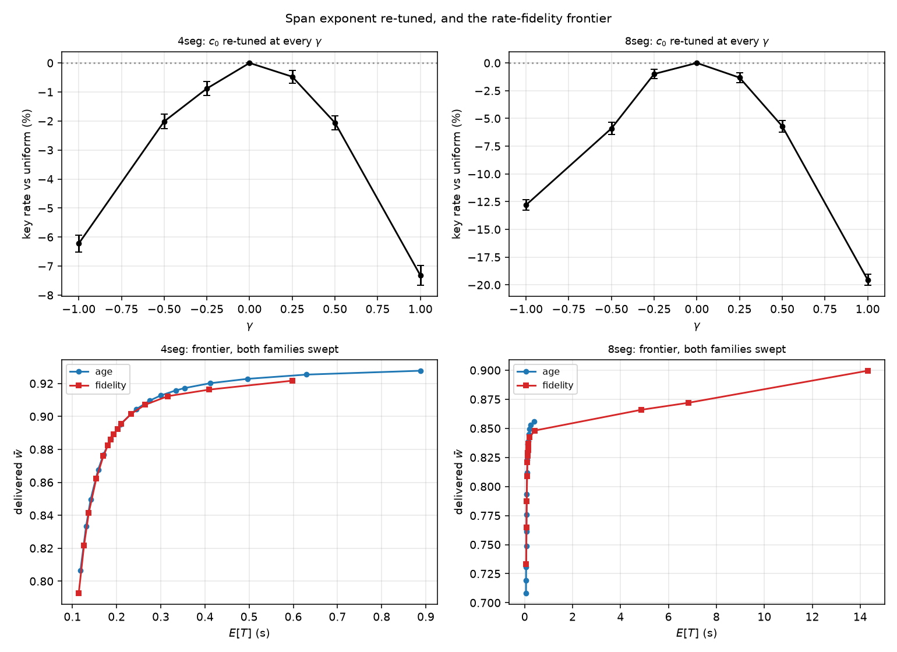

# Repeater cutoff policies

**A uniform memory cutoff is optimal in a swap-asap repeater chain, and an
accumulated-decay gate is dominated rather than trading**

Faruk Sami Bilgin (independent researcher) · Status: **Manuscript in preparation (short paper)** · [`paper/main.pdf`](paper/main.pdf)

## Question

A repeater memory cutoff (discard a stored link older than t_cut) is known to
make the secret-key rate non-monotone in the cutoff (Collins et al., PRL 98,
060502 (2007); Rozpędek et al., PRA 97, 062333 (2018); Khatri et al., PRR 1,
023032 (2019); Li, Coopmans & Elkouss, IEEE TQE 2, 4103015 (2021)). Do richer
policies help? (i) a span-indexed cutoff t_cut = c0·span^γ (the level-indexed
analogue: Santra et al., QST 4, 025010 (2019); Li et al. 2021; Reiss & van Loock,
PRA 108, 032417 (2023)); (ii) a gate on accumulated decoherence (discard when the
Werner parameter falls below w_min).

## What is reproduced

- The established conclusion (Li, Coopmans & Elkouss 2021 and the works above)
  that a uniform cutoff is optimal (γ = 0), at both geometries studied
  (4 segments / 400 km and 8 segments / 600 km; swap-asap, exponential
  dephasing, Werner states, BB84 key fraction).
- Non-monotone key rate vs cutoff (`scripts/experiments.py`, `results/results.json`):
  at 400 km, 4 segments, T_coh = 0.5 s, no cutoff gives fidelity 0.802 and zero
  key; the best scanned cutoff, 0.06·T_coh, gives 1.94 Hz.
- Generation layer validated against Praxmeyer's exact N-segment with-cutoff
  expression (arXiv:1309.3407): both proven limits to 1e-13; 22 simulated points,
  worst deviation 2.85σ, χ² = 22.9 on 22 dof. The bracket of Khatri et al.
  holds at every swept cutoff within two standard errors.

## What is new

1. **Coupling by source.** Each elementary link owns a random stream and its k-th
   generation uses that stream's k-th variate whichever policy asked, so paired
   comparisons survive policies that consume different numbers of draws. The
   gain, stated plainly: SE on the difference falls 2.4x vs unpaired, of which
   the coupling itself contributes 1.34x at matched sample count.
2. **The exponent must be separated from the scale.** Sweeping γ at fixed c0
   confounds the exponent with the cutoff magnitude. With c0 re-tuned at each γ
   the penalty for departing from γ = 0 is small and nearly symmetric:

   | γ | 4 seg, Δ key | 8 seg, Δ key |
   |---|---|---|
   | −1.00 | −6.22% | −12.80% |
   | −0.50 | −2.02% | −5.90% |
   | −0.25 | −0.88% | −0.99% |
   | +0.25 | −0.47% | −1.32% |
   | +0.50 | −2.06% | −5.71% |
   | +1.00 | −7.32% | −19.54% |

   The same γ = +0.25 point read −22.99% at 36σ in the fixed-c0 sweep; it is
   −1.32% at 2.9σ once the scale is re-optimised.
3. **Compare policies at matched delivery time.** At 4 segments the
   accumulated-decay gate coincides with the age gate (0.02% in delivered Werner
   parameter, 0.5% in key rate). At 8 segments it is **dominated on both axes**:
   a worse state (0.8289 vs 0.8364) in less time, and 10.4% lower key rate than
   the best age policy (1.18427 vs 1.32199 Hz). A mechanism consistent with the
   data (an absolute w floor acts like an effective γ ≈ −1) is offered as such,
   not as a demonstration.



## Negative results and retractions

Two claims of the earlier draft are withdrawn in the manuscript: the "strongly
asymmetric" γ landscape (a fixed-c0 artifact) and the "fidelity gate trades time
for quality" mechanism (sign backwards at matched delivery time). The tightening
of the 4-segment null is 2.45-fold, not the seventeen-fold first claimed. See
`REFEREE.md`.

Superseded artifacts kept for the record: `figures/crn_gamma_landscape.png`,
`figures/e4_level_cutoff.png` and `results/level_policy.json` are fixed-c0
landscapes; `results/policy_comparison.json` is the earlier unpaired comparison.
The manuscript's numbers come from `scripts/retune_landscape.py`
(`results/retuned_landscape.json`), `scripts/crn_driver.py`
(`results/crn_comparison.json`) and `scripts/with_cutoff_validation.py`.

## Limitations

One protocol, one decoherence model, two geometries, one figure of merit. On
expiry a rebuilt link accrues no decoherence during the rebuild wait; this is
common-mode in a paired difference but span-dependent, and its residual is not
measured.

## Repository layout and reproduction

```
paper/      main.tex, main.pdf, figs/   (build: pdflatex main.tex x3, revtex4-2, no bibtex)
figures/    figures produced by the scripts
results/    JSON data artifacts behind the numbers
scripts/    simulation code; run from the repository root
REFEREE.md  adversarial referee report on the draft
```

```bash
pip install -r requirements.txt
python scripts/<script>.py      # writes to results/ and figures/
```

## Referee pass

`REFEREE.md` reproduces the adversarial referee report that the draft went
through: which claims were overturned, and by which measurement. The manuscript
in `paper/` is the revised version. Keeping the record public is deliberate.

## Related work by the author

- Twisted hBN preprint: https://doi.org/10.5281/zenodo.24201814
- Twisted MoS2 hole-spin coherence preprint: https://www.alphaxiv.org/abs/2611.twisted-mos2-hole-spin-coherence
- Moiré microwave loss preprint: https://doi.org/10.5281/zenodo.24204124
- josim-cpr-bridge (software): https://github.com/FarukSamiBilgin/josim-cpr-bridge

## AI assistance

AI assistance: AI coding assistants were used for code development and for adversarial review. All load-bearing results were re-derived by independent methods and checked by automated tests; the author is responsible for every claim.

## Citation

Faruk Sami Bilgin, *A uniform memory cutoff is optimal in a swap-asap repeater chain, and an accumulated-decay gate is dominated rather than trading*, short paper, manuscript in preparation (2026).
Code and data: https://github.com/FarukSamiBilgin/repeater-cutoff-policies (see `CITATION.cff`).
ORCID: [0009-0001-9064-4410](https://orcid.org/0009-0001-9064-4410)

## License

Code in `scripts/`: MIT (`LICENSE`). Manuscript, figures, data and prose:
CC BY 4.0 (`LICENSE-CONTENT`).
